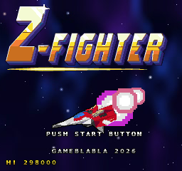
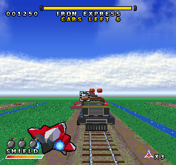
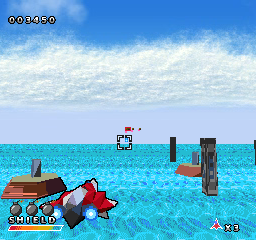
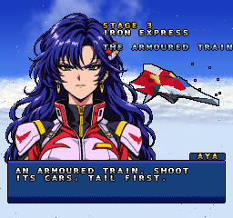

# Z-Fighter

Z-Fighter is a 3D shmup Homebrew Game for the NEC PC-FX by yours truly gameblabla.

It features 6 levels with 3D texture-mapped polygons and LOD system (both flat shaded and sprite LOD), bosses that can have more than 300 triangles on screen at 15 FPS during gameplay, on top of the main ship itself with black outlines and 180 triangles.

You control Aya, a space pilot in search for better opportunities and her affectionate spaceship named Spike.

Space terrorists have taken over the moon and many other locations, and Aya took it upon herself to foil their plans.

Do you have what it takes to go through this game ?

Find out in Z-Fighter !

(Note, LLMs were extensively used for the development for this game)
